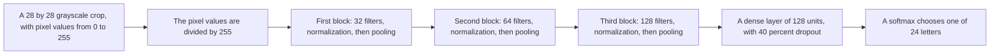
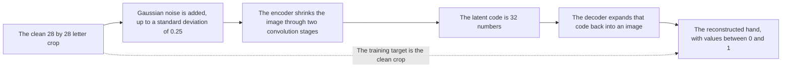
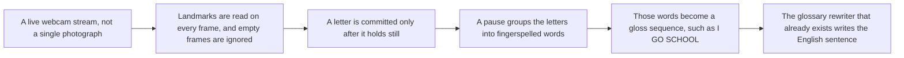

# SignLingo

**Static American Sign Language letter recognition, reconstruction, and gloss rewriting**

## 1. Title

SignLingo: a desktop system for static ASL fingerspelling that classifies 28×28 letter images with a convolutional neural network, reads a camera photo from hand landmarks, reconstructs noisy letter crops with a denoising autoencoder, and rewrites a short list of known glosses into English.

## 2. Abstract

SignLingo demonstrates static American Sign Language letters, not full signed sentences from video. A convolutional neural network was trained on Sign Language MNIST. The 27,455 images in the training CSV were split, stratified by letter, into 21,964 training images and 5,491 hold-out images (`random_state=42`). On that hold-out set the CNN reached **99.95% accuracy** and **100% top-3 accuracy**. That score is for the dataset crops only.

A separate denoising autoencoder was trained on the same split. It compresses each 28×28 crop into 32 numbers and rebuilds the hand. Noisy hold-out images have mean squared error **0.0496**. Reconstructions of those noisy images have error **0.0063**.

The Streamlit application has six pages. A camera photo or upload is read from 21 MediaPipe hand landmarks by a geometric hand-shape procedure. The gallery runs the trained CNN on one hold-out crop per letter. The autoencoder page shows the original crop, a noisy copy, the reconstruction, and the latent code. Typed glosses such as `I GO` are rewritten by grammar rules (`I am going.`). Saved predictions are stored and are not used to update weights.

Live sentence recognition, where a webcam watches a sequence of signs and builds the English line by itself, is future work. It is not in the current demo.

## 3. Objectives

1. Recognize one static ASL letter.
2. Train a deep classifier and report a measured train and hold-out result.
3. Train an encoder–decoder that reconstructs the same letter images, including from noise.
4. Show a camera photo, a dataset gallery, the autoencoder, typed sentence rewriting, and prediction history in one desktop app.
5. Keep the camera path, the CNN path, and the autoencoder path separate, so a dataset score is not presented as a webcam score.
6. Leave continuous live sentence formation as a stated next step.

## 4. What this copy of the project contains

The folder began as the SignLingo repository (`ishgit/sign-language-project`), a word-level pipeline aimed at WLASL videos: MediaPipe landmarks over a short frame sequence, then one of Vision Transformer, bidirectional LSTM with attention, ResNet-50, VGG-16, or VGG-19, then a rule-based gloss-to-English module.

Those sequence models are still in `signlingo/models/`. They were **not trained in this project**. The WLASL videos and `models/sign_language_model.h5` are not in this folder. An older note of about 88% Vision Transformer accuracy came with the download and was not measured again here.

What was built and measured here:

| Piece | Kind | Role |
| --- | --- | --- |
| Sign Language MNIST CNN | Deep learning | Classifies a 28×28 grayscale crop into 24 letters |
| Denoising convolutional autoencoder | Deep learning | Compresses a crop to 32 numbers and rebuilds the hand |
| MediaPipe Hand Landmarker | Pretrained vision model | Finds up to one hand and 21 landmarks in a photo |
| Landmark letter procedure | Geometric rules | Turns those 21 points into a letter and a confidence |
| Gloss rewriter | Rule-based language module | Turns a known gloss list into an English sentence |
| Streamlit app | Application | Camera, gallery, autoencoder, sentence, history, about |
| Prediction history | Storage | Last 500 saved readings in `data/prediction_history.json` |

scikit-learn is used for the stratified split, accuracy, top-3 accuracy, and the confusion matrix. It is not the letter classifier.

## 5. Architecture

Three paths run in the application. They do not share weights.


The camera path never sends the photo into the CNN. Sign Language MNIST crops do not look like a webcam frame, so that substitution is unreliable. The autoencoder does not output a letter. The sentence page does not watch the camera.

### 5.1 Alphabet CNN



### 5.2 Denoising autoencoder



## 6. Dataset

**Name.** Sign Language MNIST, the public training CSV (Kaggle set by tecperson / datamunge, GitHub mirror used by `scripts/train_alphabet.py`).

**File.** `data/sign_mnist/sign_mnist_train.csv`

**Size.** 27,455 rows. Each row is one integer label plus 784 grayscale pixel values. The pixels reshape to a 28×28 image.

**Labels.** Raw labels 0–24 map to A–Y. Label 9, the letter J, does not appear. Z is also absent. Both letters are drawn with motion, so they are outside this dataset and outside every model trained here. The working label set has **24 classes**: A B C D E F G H I K L M N O P Q R S T U V W X Y.

**What is not in the folder.** The official Sign Language MNIST test CSV, WLASL videos, and Indian Sign Language data.

## 7. Train and test split

Both trained models use the same split, because the official test file is not in this folder.

| Item | Value |
| --- | --- |
| Method | Stratified hold-out, so each letter keeps its share of the data |
| Ratio | 80% train, 20% hold-out |
| Random seed | 42 |
| Training images | 21,964 |
| Hold-out images | 5,491 |
| Leakage control | The hold-out images are not used to update weights. Early stopping watches them and then restores the best weights. |

This is a hold-out of the public training CSV. It is not the publisher’s official test split, so the numbers should be described that way.

## 8. Deep learning models that were trained

### 8.1 Alphabet CNN

| Item | Value |
| --- | --- |
| File | `signlingo/models/alphabet_cnn.py` |
| Weights | `models/alphabet_cnn.keras` |
| Task | 24-way classification |
| Input | 28×28×1, pixel values 0–255, rescaled by 1/255 inside the network |
| Convolution blocks | 32, 64, then 128 filters, each 3×3, same padding, ReLU, batch normalization, max-pool |
| Head | Flatten, dense 128 with ReLU, dropout 0.4, softmax |
| Loss | Sparse categorical cross-entropy |
| Optimizer | Adam, learning rate 0.001 |
| Batch size | 128 |
| Epoch budget | Up to 8, early stopping on hold-out accuracy, patience 2, best weights restored |
| Epochs run | 6 |
| Last-epoch training accuracy | 99.76% |
| Last-epoch hold-out accuracy | 99.13% |
| Hold-out accuracy after restoring the best weights | **99.95%** |
| Hold-out top-3 accuracy | **100%** |

The last epoch is not the reported score. Early stopping restored an earlier checkpoint, and that checkpoint is what was measured at 99.95%. Records and the confusion matrix are in `results/alphabet_metrics.json` and `results/alphabet_confusion_matrix.png`. One hold-out crop of each letter is stored in `results/alphabet_samples.npz` for the gallery.

A 99.95% score means these processed 28×28 images are easy for this CNN to separate. It does not mean a phone photo will score 99.95%.

Training command:

```powershell
.\.venv\Scripts\python.exe scripts\train_alphabet.py
```

### 8.2 Denoising autoencoder

| Item | Value |
| --- | --- |
| File | `signlingo/models/sign_autoencoder.py` |
| Weights | `models/sign_autoencoder.keras` |
| Task | Reconstruct the clean letter crop |
| Input and output | 28×28×1, values in 0 to 1 |
| Encoder | Conv 32, max-pool to 14×14, conv 64, max-pool to 7×7, flatten, dense layer of 32 units |
| Decoder | Dense layer to 7×7×64, two stride-2 transposed convolutions, final 3×3 convolution with sigmoid |
| Noise during training | Each sample gets its own Gaussian noise level, drawn uniformly from 0 up to standard deviation 0.25 |
| Loss | Mean squared error |
| Optimizer | Adam, learning rate 0.001 |
| Batch size | 256 |
| Epochs | 12 |
| Final training loss | 0.005071 |
| Final hold-out loss | 0.006312 |
| Hold-out noisy-input error | **0.049586** |
| Hold-out reconstructed error | **0.006312** |
| Hold-out clean reconstruction error | **0.004386** |

The reconstructed error is lower than the noisy-input error, so the decoder removes noise instead of copying it. A grid of original, noisy, and reconstructed letters A–H is in `results/autoencoder_reconstructions.png`. Metrics are in `results/autoencoder_metrics.json`.

Training command:

```powershell
.\.venv\Scripts\python.exe scripts\train_autoencoder.py
```

## 9. Models used that were not trained here

### 9.1 MediaPipe Hand Landmarker

`signlingo/data/hands_runtime.py` loads Google’s MediaPipe Tasks hand landmarker (`models/mp/hand_landmarker.task`). On a still photo it returns up to one hand. Each hand has 21 points with x, y, and z. This project does not train MediaPipe. It uses the released detector.

### 9.2 Landmark letter procedure

`signlingo/models/landmark_alphabet.py` is not a neural network. From the 21 points it measures finger extension, thumb position, and whether the palm faces the camera, then picks one of the 24 letters. If the top two letters are close, confidence is reduced. J and Z are omitted because they need motion. Fist letters (A, S, T, M, N) are easier to confuse because their landmarks are similar. Open letters (B, V, L, Y, W, I) are clearer.

### 9.3 Gloss rewriter

`signlingo/sentence/formation.py` maps a small glossary to parts of speech and rewrites the sequence into English. Example: `I GO` becomes `I am going.` The rewriter runs only when every token is in the glossary (pronouns, a short verb and noun list, a few adjectives, time words, and responses such as YES and NO). Unknown words are left as typed text. This is not a trained translator.

### 9.4 Sequence networks left in the repository

These files exist and were not given a measured accuracy in this project, because the WLASL landmark sequences were not available:

- Vision Transformer (`signlingo/models/vit.py`)
- Bidirectional LSTM with attention (`signlingo/models/lstm_attention.py`)
- ResNet-50 (`signlingo/models/resnet.py`)
- VGG-16 and VGG-19 (`signlingo/models/vgg.py`)

## 10. Application

**File.** `app.py`  
**Launch.** `run_app.bat`  
**Address.** http://localhost:8510

The interface is a dark Streamlit app. The sidebar is grouped into Camera, Dataset, and Language. Gallery accuracy and denoising error are shown on their own pages, not in the sidebar.

| Page | What it does |
| --- | --- |
| Recognize | Camera photo or upload. Draws the hand, shows the letter, confidence, and top 3. Save writes one history row. |
| Hold-out samples | One dataset image per letter that the CNN did not train on. Caption is the CNN prediction and the true letter. |
| Autoencoder | Original crop, noisy input, reconstruction, and the 32-number latent code. Noise slider from 0 to 0.60. An upload is resized to 28×28 grayscale. |
| Sentence | Typed glosses. Known glosses are rewritten in English. |
| History | Table of saved readings. Clear deletes them. At most 500 rows are kept. |
| About | States the limits of the demo and shows the measured JSON records. |

Saving a prediction does not change any weights.

## 11. Tools

| Tool | Use |
| --- | --- |
| Python 3.14 | Application and training scripts |
| TensorFlow and Keras | CNN and autoencoder |
| MediaPipe Tasks | Hand landmarks |
| OpenCV | Image decode, drawing, resize |
| scikit-learn | Stratified split, accuracy, top-3 accuracy, confusion matrix |
| pandas | Reading the MNIST CSV |
| Streamlit | Desktop interface |
| NumPy, Matplotlib | Arrays and the saved result figures |

Training in this environment was on CPU.

## 12. Results to quote

| Result | Number | Applies to |
| --- | --- | --- |
| CNN hold-out accuracy | 99.95% | 5,491 Sign Language MNIST crops |
| CNN hold-out top-3 | 100% | Same crops |
| Autoencoder noisy-input MSE | 0.0496 | Same split, noise standard deviation 0.25 |
| Autoencoder reconstructed MSE | 0.0063 | Reconstruction versus the clean crop |
| Autoencoder clean reconstruction MSE | 0.0044 | Clean crop in, clean crop as the target |
| Camera letter accuracy | Not measured as a dataset percentage | Landmark rules on a still photo |

## 13. How to run

```powershell
cd "C:\Users\yashr\OneDrive\Desktop\sign-language-project-main\sign-language-project-main"
.\run_app.bat
```

Open http://localhost:8510. The trained weights are already saved, so the gallery and the autoencoder pages run without another training pass. If port 8510 is already in use, stop the old server and run `run_app.bat` again.

## 14. Limits

1. The working recognition task is static letters, not WLASL words and not a continuous signed sentence.
2. J and Z are outside the label set.
3. The 99.95% figure is a dataset hold-out score, not a camera score.
4. Camera photos use landmark rules. Fist letters are easy to confuse.
5. The sentence line is a fixed glossary, and the user types it. The camera does not produce it.
6. The autoencoder reconstructs 28×28 crops. It does not classify the letter and it does not read the live camera path.
7. LSTM, ResNet, VGG, and the Vision Transformer were not trained in this submission.
8. Saving a prediction does not improve the model.

## 15. Future enhancement: live sentences

The sentence page today waits for typed glosses. The intended next version watches the camera continuously and builds the sentence itself.



That version would:

1. Read the webcam as a stream, not as one still photo.
2. Track the hand from frame to frame and ignore frames with no hand.
3. Commit a letter only when the same letter stays stable for a short hold, so a moving hand does not spam the line.
4. Treat a pause, or a second hand cue, as the gap between words.
5. Pass the resulting gloss sequence, such as `I GO SCHOOL`, into the rewriter that already exists.
6. Add J and Z only after a small motion model exists, because a single frame cannot represent them.
7. Show the growing English sentence on screen and keep saving optional.

Until that work is done, the honest description is: letters can be recognized from one photo, and sentences can be formed from typed glosses. The system does not yet watch a person sign a sentence live.

## 16. Conclusion

SignLingo, in this folder, is a measured static-letter system. A CNN classifies Sign Language MNIST crops at 99.95% hold-out accuracy. A denoising autoencoder rebuilds those crops, cutting hold-out error from 0.0496 to 0.0063. A camera photo is handled separately by MediaPipe landmarks and hand-shape rules. Typed glosses can be rewritten in English, and saved readings are kept as history. Word-level video models were not trained. Live sentence recognition remains the next step.

## 17. References

1. Sign Language MNIST, Kaggle, dataset by tecperson / datamunge.
2. MediaPipe Hand Landmarker, Google.
3. TensorFlow and Keras documentation.
4. ishgit/sign-language-project, the original SignLingo repository.
5. Dosovitskiy et al., “An Image is Worth 16×16 Words” (Vision Transformer), for the ViT design that remains in the original code and was not trained here.
